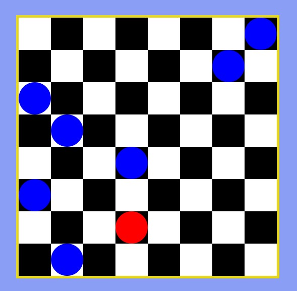
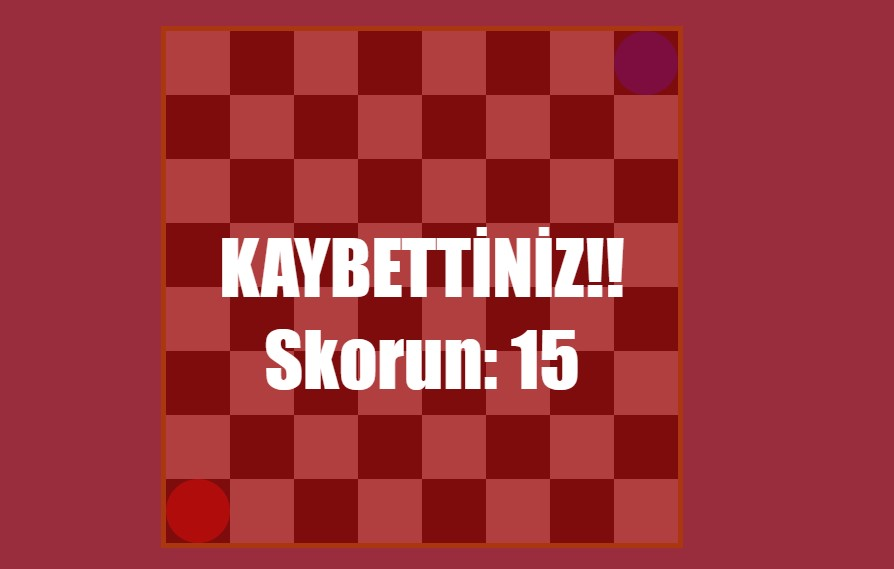

# One Red Lot of Blue

**HTML5 Canvas ve saf JavaScript ile yazılmış, sıra tabanlı bir tahta oyunu.** Bir kırmızı taşı yönetirsin. Tahtanın üstünden mavi düşmanlar iner. Görevin, düşmanlar tahtanın altından çıkmadan onları yakalamak.

▶️ **[Tarayıcıda hemen oyna](https://nurgull6872.github.io/one-red-lot-of-blue/)** · 🎬 **[Tanıtım videosu (YouTube)](https://www.youtube.com/watch?v=eMAcy58IOiQ)**



Oyunun temel dinamiği [Shotgun King: The Final Checkmate](https://punkcake.itch.io/shotgun-king) oyunundan esinlenildi. Görsel olarak ise dama ve satranç tahtasından ilham alındı.

## Nasıl oynanır?

| | |
|---|---|
| **Sen** | 🔴 Kırmızı taş. Sol alt köşeden (`x=0, y=7`) başlarsın |
| **Düşmanlar** | 🔵 Mavi taşlar. En üst satırda rastgele bir sütunda doğarlar |
| **Puan** | Bir mavi taşın bulunduğu kareye girersen onu yakalarsın: **+1 puan** |
| **Kaybetme** | Bir mavi taş en alt satırı geçip tahtanın dışına çıkarsa oyun biter |

### Sıra düzeni
Oyunu ilginç yapan kural şu: **Sen iki hamle yaparsın, düşmanlar bir hamle yapar.** Her ikinci hamlende:
1. Bütün mavi taşlar bir kare aşağı iner.
2. Tahtadan çıkan taş var mı diye kontrol edilir.
3. En üst satıra yeni bir mavi taş eklenir.

Bu yüzden ikinci hamleni yaparken dikkatli olmalısın. Hedeflediğin mavi taş o anda bir alt satıra kayacağı için elinden kaçabilir. Düşmanın bir sonraki konumunu tahmin ederek oynamak gerekiyor.

### Kontroller
8 yöne hareket edebilirsin: 4 düz yön ve 4 çapraz yön.

| Tuş | Yön | | Tuş | Yön |
|:---:|---|---|:---:|---|
| ← | Sola | | **W** | ↖ Sol yukarı |
| ↑ | Yukarı | | **A** | ↙ Sol aşağı |
| → | Sağa | | **S** | ↘ Sağ aşağı |
| ↓ | Aşağı | | **D** | ↗ Sağ yukarı |

Oyun bittiğinde ekranda **"KAYBETTİNİZ!!"** yazısı ve skorun görünür. Yeniden oynamak için sayfayı yenile.



## Kurulum

Kurulum gerekmez. Herhangi bir kütüphane ya da derleme adımı yok.

1. Depoyu indir: `git clone https://github.com/nurgull6872/one-red-lot-of-blue.git`
2. `index.html` dosyasını tarayıcıda aç.
3. Bir tuşa bas. Müzik başlar ve oyun hazır.

Ya da doğrudan **https://nurgull6872.github.io/one-red-lot-of-blue/** adresinden oyna.

## Teknik ayrıntılar

| | |
|---|---|
| **Diller** | HTML5, CSS, JavaScript (framework yok) |
| **Çizim** | Canvas 2D API: 512×512 piksel tuval, 8×8 tahta, 64 piksellik kareler |
| **Ses** | HTML5 `<audio>`: döngüde arka plan müziği, yakalama ve yenilgi efektleri |

**Oyun nasıl çalışıyor?** Sürekli dönen bir oyun döngüsü yok. Oyun tamamen **olay güdümlü** çalışıyor: Her tuş basışında durum güncelleniyor ve tahta baştan çiziliyor. Sıra tabanlı bir oyun için bu, gereksiz yere her karede çizim yapmaktan daha basit ve verimli.

Öne çıkan bazı kararlar:
- **Durum modeli:** Oyuncu tek bir `{x, y}` nesnesi. Düşmanlar ise bir nesne dizisinde tutuluyor.
- **Yakalama:** İki taşın merkezleri arasındaki uzaklık hesaplanıyor. Uzaklık yarım kareden küçükse yakalama sayılıyor. Yakalanan düşmanlar `Array.filter()` ile diziden çıkarılıyor.
- **Kaybetme kontrolü:** `Array.some()` ile tahtanın dışına çıkan herhangi bir düşman olup olmadığına bakılıyor. İlk eşleşmede arama duruyor.
- **Sınır kontrolü:** Oyuncunun tahtanın dışına çıkmasına izin verilmiyor. Geçersiz hamleler sayılmıyor, yani sıra düzenini bozmuyor.
- **Tarayıcı otomatik oynatma kısıtı:** Tarayıcılar kullanıcı etkileşimi olmadan ses çalmaya izin vermiyor. Bu yüzden arka plan müziği ilk tuş basışında başlatılıyor.
- **Yenilgi ekranı:** HTML'de gizli duran bir katman. Oyun bitince JavaScript ile görünür hâle geliyor ve klavye girişi kapatılıyor.

## Dosya yapısı

```
one-red-lot-of-blue/
├── index.html          # Sayfa düzeni, skor alanı, yenilgi ekranı, ses etiketleri, canvas
├── script.js           # Oyun mantığı: çizim, hareket, düşmanlar, yakalama, kaybetme
├── music/
│   ├── loopmusic.mp3   # Arka plan müziği
│   ├── win.wav         # Düşman yakalama sesi
│   └── die.wav         # Oyun bitti sesi
├── screenshots/
│   ├── playekran.jpg
│   └── defeatekran.jpg
└── AI.md               # Geliştirme sırasında yapay zekâya sorduğum sorular ve aldığım yanıtlar
```

## Kaynaklar

- İlham: [Shotgun King: The Final Checkmate](https://punkcake.itch.io/shotgun-king)
- Ses efektleri ve müzik: [Freesound](https://freesound.org)

## Geliştirme fikirleri

- Oyun bitince sayfayı yenilemeden **"Yeniden başla"** butonu
- Zorluk seviyeleri: puan arttıkça düşmanların daha sık gelmesi
- En yüksek skorun tarayıcıda saklanması
- Dokunmatik ekran desteği

**Keyifli oyunlar!**
